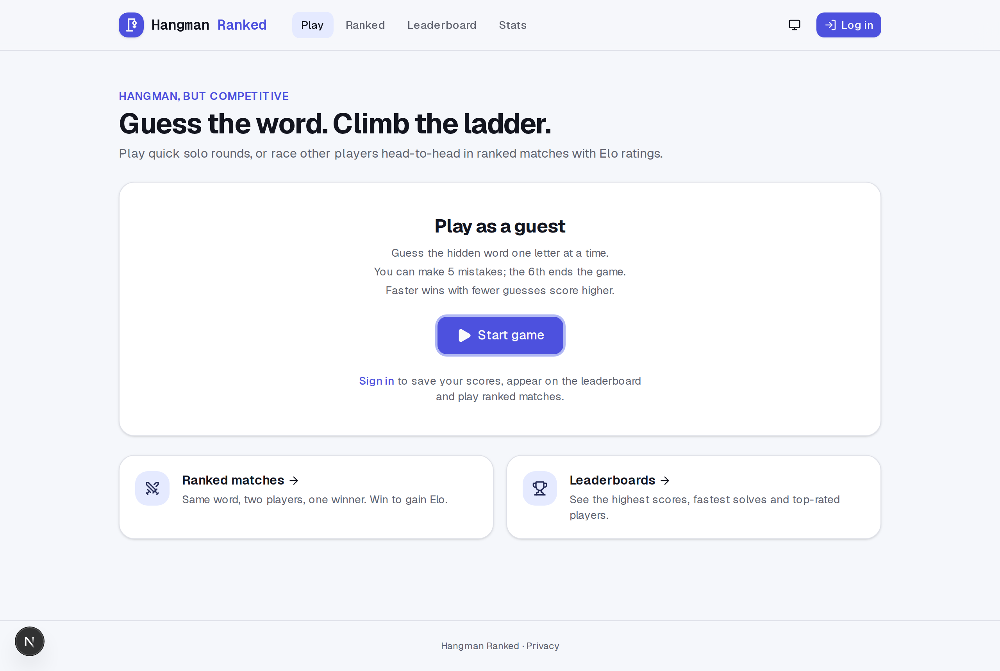
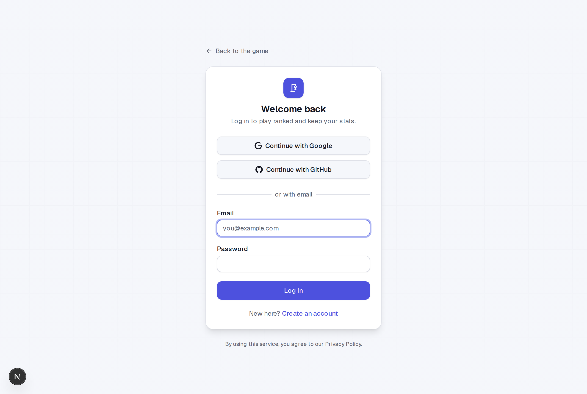
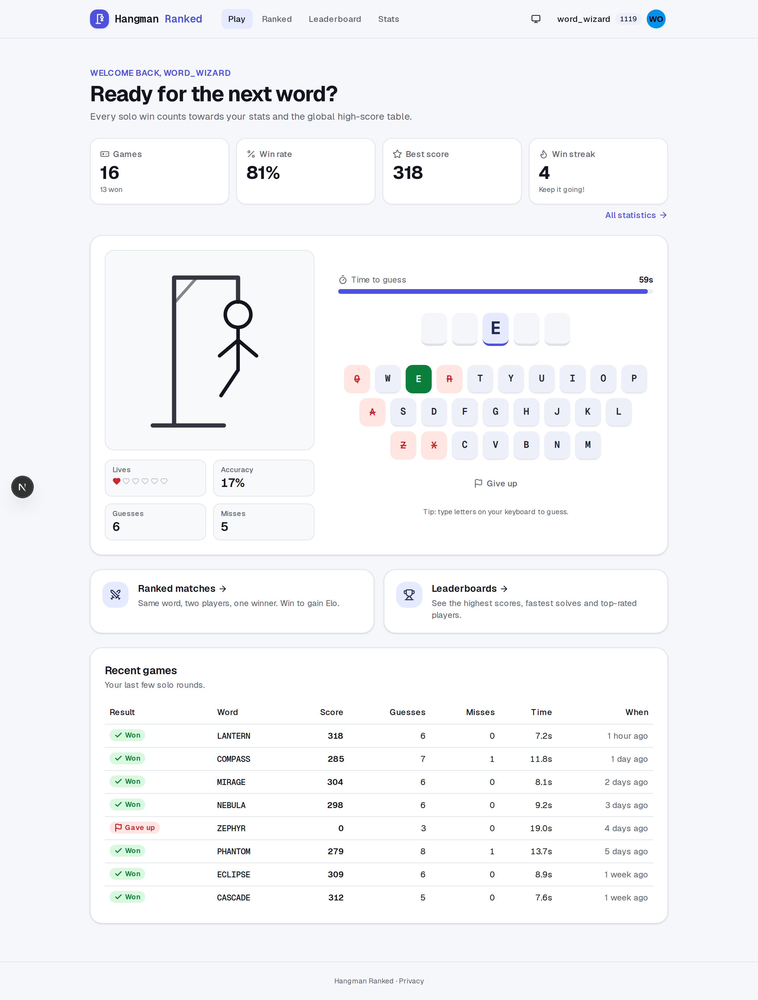
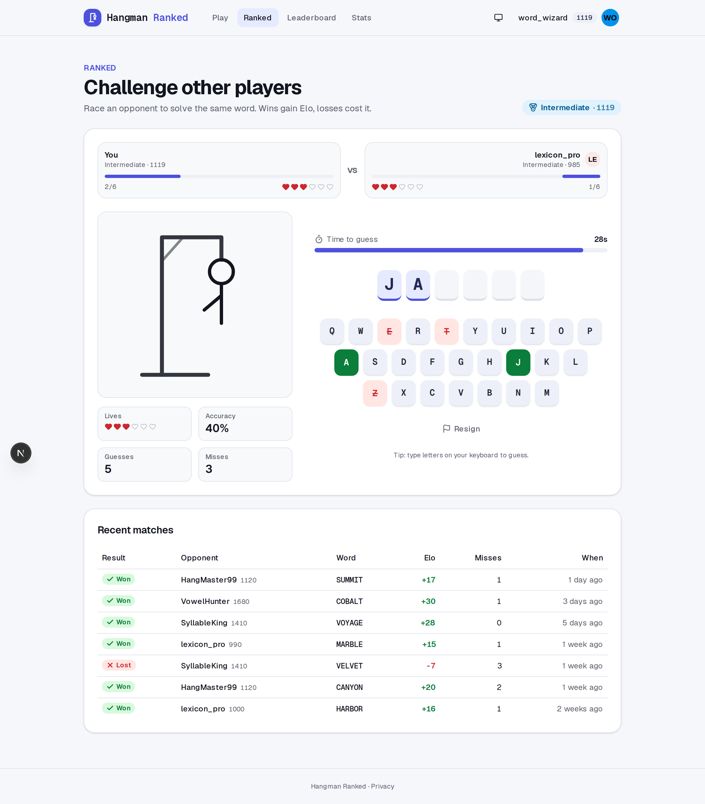
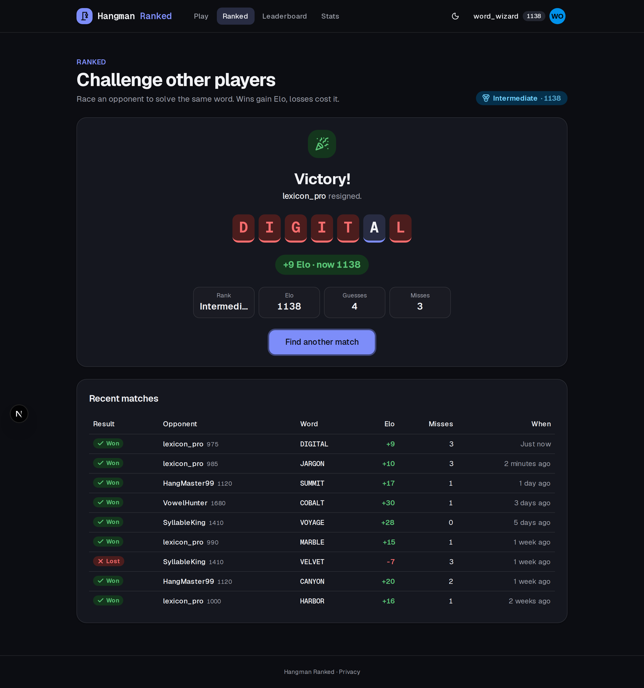
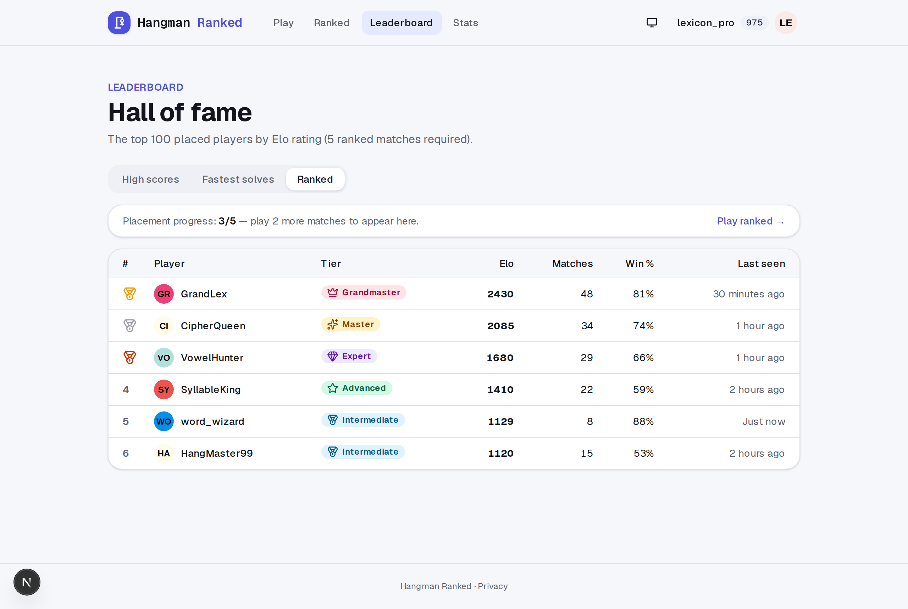
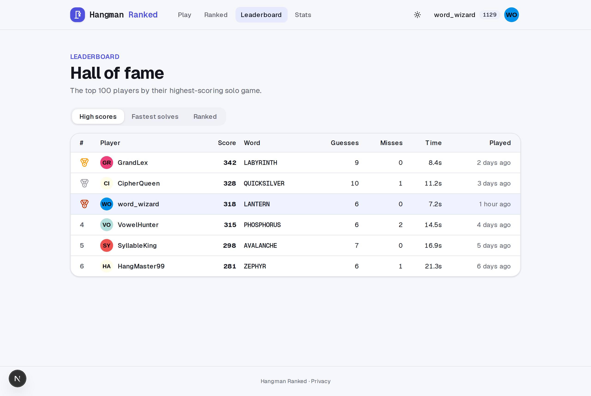
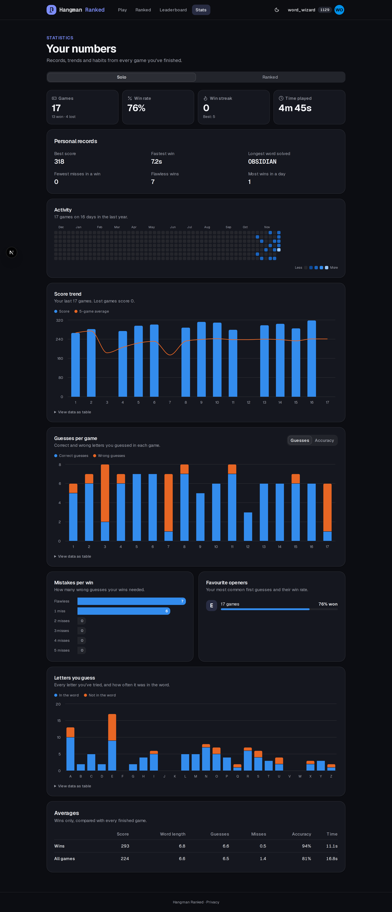
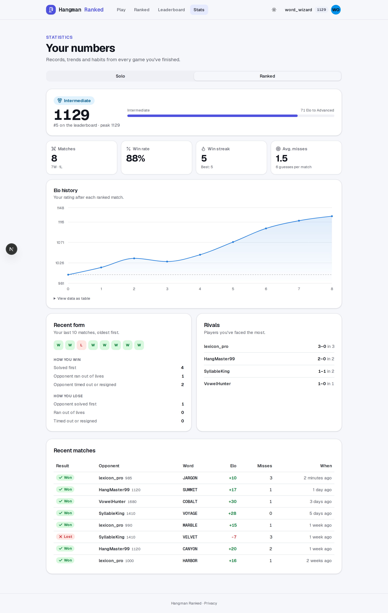
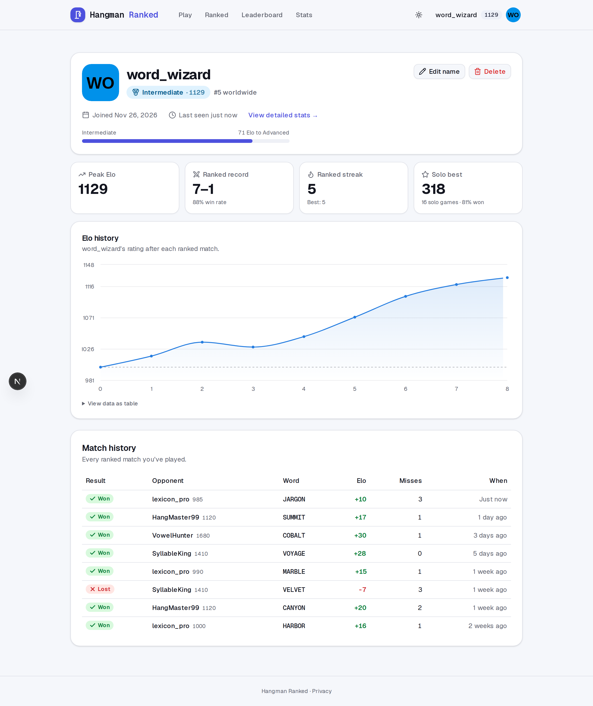

# Hangman Ranked — UI Walkthrough

Screenshots of the redesigned application captured against a live local Convex + Next.js instance on branch `ccr-5951b796-pl635i`.

## 1. Guest Landing Page

## 2. Sign In / Create Account

## 3. Signed-In Home & Active Solo Game

## 4. Live Head-to-Head Ranked Match

## 5. Ranked Victory Screen (Dark Mode)

## 6. Ranked Leaderboard (with Placement Progress Banner)

## 7. Solo High-Scores Leaderboard

## 8. Solo Statistics & Charts (Dark Mode)

## 9. Ranked Statistics & Elo History

## 10. Player Profile Page

